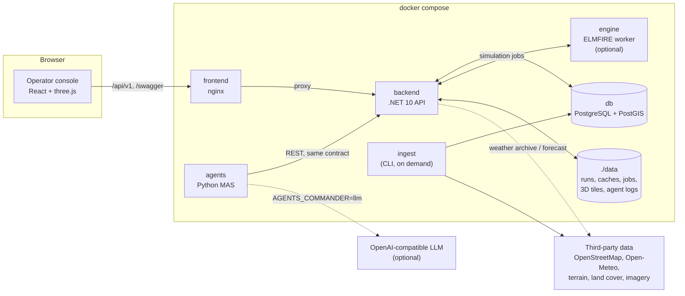

# Escudo Floriano (FireTrace)

> **A 3D tactical console for rural wildfire response.** It simulates how a fire spreads over real terrain, weather and roads, asks a
> multi-agent system for two candidate response plans (A and B), and simulates each plan before anyone commits to it.
>
> *«Proteger quem nos protege.»* — Built for Hack4Guimarães 2035. The product is **Escudo Floriano**; the code, API and namespaces are
> still **FireTrace**. They are the same system.

The pilot area is the municipality of Guimarães (Penha and the whole concelho). The console is for the people who decide — **Bombeiros,
GNR, INEM, PSP and Proteção Civil** — and answers three questions:

1. **Where is the fire going?** — physical spread over real elevation, fuel, roads and weather, with an ensemble of possible futures.
2. **What should each organization do?** — two plans, **A** (lives first, maximum attack) and **B** (defensive), made of per-organization
   actions: dispatch units, close roads, evacuate, shelter in place, protect houses, medical standby, air support…
3. **What happens if we do that?** — every plan can be simulated against the same fire ("what-if"), including the units driving there,
   refilling, resting and being caught by the fire.

The rule the whole system is built on: **agents propose, physics and validation dispose.** No planner guesses whether an action works;
it publishes the plan, asks the backend to simulate it and reads the answer.

---

## Quick start

Requirements: **Docker** (Compose v2). Nothing else is needed to run the demo — the backend image builds the .NET API, the agents image
builds the Python service, and the frontend image builds the React app.

```powershell
Copy-Item .env.example .env        # optional: ports, DB credentials, agents settings
docker compose up -d --build
```

The `engine` image (ELMFIRE + Fortran toolchain) is heavy and only used when `Provider: elmfire`. To skip it:

```powershell
docker compose up -d --build db backend agents frontend
```

| What | Where |
|---|---|
| Operator console | <http://localhost:8081> |
| API / Swagger | <http://localhost:8080/swagger> |
| OpenAPI document | <http://localhost:8080/openapi.json> |
| Health / capabilities / rules | <http://localhost:8080/api/v1/health> · `/capabilities` · `/rules` |
| PostgreSQL + PostGIS | `localhost:5440` (volume `pgdata`) |

The **first start takes several minutes**: the backend ingests the location's map data (terrain, land cover, roads, buildings, places,
water), seeds scenarios/resources and warms up one baseline simulation per example incident. The app is usable while that runs; panels
show a loading state.

Load a location explicitly (optional — the backend also ingests missing ones on boot):

```powershell
docker compose --profile ingest run --rm ingest --location guimaraes
```

**Never run `docker compose down -v`** — it deletes `pgdata` (the ingested maps and all API state).

### Asking the agents for a plan

1. Open a scenario, or start a simulation from the **Incidente** tab.
2. In **Planos**, press **Pedir novo plano aos agentes** (optional note + the decision minute on screen).
3. The `agents` service claims the request and reports every step; plans A and B appear with their what-if effect on the fire.

```powershell
docker compose logs -f agents
```

The agents service seeds a maximum-alert day's demo fleet on start (`AGENTS_SEED_DEMO=1`): aircraft, pre-positioned crews and
reinforcements from neighbouring districts. Set `AGENTS_SEED_DEMO=0` to keep only the backend's own resources.

---

## Architecture at a glance



| Service | Technology | Port | Role |
|---|---|---|---|
| `db` | PostgreSQL 16 + PostGIS 3.4 | `5440` → `5432` | API documents (`documents` table, JSONB) and each location's map (terrain, roads, places…). |
| `backend` | .NET 10 | `8080` | The Coordination API: simulation queue, native fire engine, routing, plans, dispatches, analysis. |
| `engine` | Python + ELMFIRE (Fortran) | `9000` (internal) | Optional high-fidelity engine, used when `FireTrace:Engine:Provider = elmfire`. |
| `ingest` | backend image, target `ingest` | — | One-off download of a location's third-party data. Compose profile `ingest`. |
| `agents` | Python 3.12 | — | Multi-agent planning service: watches plan requests, publishes A/B, judges candidates. |
| `frontend` | React 18 + TypeScript + Vite, served by nginx | `8081` | 3D operator console; nginx also proxies `/api/` and `/swagger` and serves local 3D city tiles. |

Two Docker networks: `firetrace-network` (everything) and `firetrace-proxy` (only nginx and the backend, fixed subnet). The backend
trusts `X-Forwarded-For` only from nginx, which is what makes per-IP rate limiting meaningful.

---

## Repository map

```text
api-spec/openapi.json   THE contract (OpenAPI 3.1, 71 paths, 262 schemas, base /api/v1)
backend/                .NET 10: FireTrace.Core (API), FireTrace.Engine (fire physics), FireTrace.ExternalData (ingest), tests
frontend/               React + TypeScript + three.js operator console
agents/                 Python multi-agent system (orchestrator, firefighters, GNR, INEM, Proteção Civil, LLM commander)
engine/                 Python HTTP worker around ELMFIRE (the optional engine) + engine comparison
locations/              one JSON per pilot area: extent, grid, curated facilities, example incidents
data/                   runtime: simulation runs, engine cache, ELMFIRE jobs, imagery, 3D tiles, LLM logs (partly checked in)
docs/                   ARCHITECTURE.md (end-to-end), IMPROVEMENT_PLAN.md (audit)
tools/                  fetch_tiles3d.py — one-time download of Google Photorealistic 3D Tiles
AGENTS.md / CLAUDE.md   repo-wide rules for people and AI coding agents
PROTOCOL.md             cross-vertical handover and contract-change process
docker-compose.yaml     db, engine, backend, ingest (profile), agents, frontend
```

**Four verticals, one contract.** `backend/`, `frontend/`, `agents/` and `engine/` are clients of `api-spec/openapi.json` — the spec
defines the interface, not whatever happens to be implemented. Contract changes go through `PROTOCOL.md` first, then land in the spec,
backend DTOs and generated frontend types together. Each vertical has its own technical rules in `backend/AGENTS.md`,
`frontend/AGENTS.md`, `agents/AGENTS.md` and `engine/AGENTS.md`.

---

## What is implemented

### The contract (`api-spec/openapi.json`)

OpenAPI 3.1, base path `/api/v1`, written in Portuguese. Groups:

| Group | Tags |
|---|---|
| **Resources** | Locations, Terrain, Organizations, Stations, Vehicles, Personnel, Equipment, Resources, Road Closures, Weather, Scenarios |
| **Simulation & analysis** | Simulations, Results, Routing |
| **Decisions** | Dispatches, Plans, Actions |
| **Meta** | `/health`, `/capabilities`, `/rules` |

House conventions: `camelCase` fields, `snake_case` enum values, opaque string ids, RFC 3339 times, units in field names (`…Kmh`,
`…Ha`, `…Kwm`), GeoJSON `[lon, lat]` but `LatLon {lat, lon}` for a point, **wind "from"** (`windFromDeg`), cursor pagination
(`{items, nextCursor}`), `PATCH` with `application/merge-patch+json`, `application/problem+json` errors with a stable `code`, and
`GET /capabilities` to tell "not implemented yet" apart from a contract mistake.

The spec is executable: `npx @stoplight/prism-cli mock api-spec/openapi.json` serves its own examples, and
`openapi-generator` / `openapi-typescript` can generate clients from it. The backend keeps 1:1 coverage with contract tests.

### Backend (.NET 10)

Three projects with one responsibility each; architecture tests enforce the boundaries:

| Project | Role |
|---|---|
| `FireTrace.Core` | The API: controllers, services, repositories, domain, policies, hosting. |
| `FireTrace.Engine` | The fire: native C# physics and the ELMFIRE bridge, plus the result cache. |
| `FireTrace.ExternalData` | Everything from third-party APIs, fetched once and stored in PostGIS/files. Also the `ingest` CLI. |

**Simulation pipeline.** `POST /simulations` snapshots the scenario, validates it and returns `202`. A single worker then builds the
landscape (8 terrain/fuel bands + per-cell barriers from roads, firebreaks and waterways), resolves weather (Open-Meteo archive/forecast
or a programmable timeline with timed events), runs a seeded **ensemble of 12 members** (up to 24; wind speed ×0.75–1.25, direction
σ 15°, humidity ×0.85–1.15), optionally couples the wind the fire itself induces, and stores the result. Everything clients ask for is
derived on demand from the stored grids: perimeters, spread vectors, summary, impact, threatened places, road status, smoke, raw binary
grids, and the plan's unit simulation.

**Fire physics.** The default `native` engine implements Rothermel (1972) with the full Scott & Burgan 40 fuel models, size-class
weighting, live/dead moisture, Andrews' wind adjustment factor, Van Wagner crown-fire initiation/active crowning, Byram intensity and an
elliptical minimum-travel-time front. Rain, gusts, live-fuel damping and timed suppression are supported. **ELMFIRE** remains available
as the high-fidelity validation provider (`Provider: elmfire`, level-set propagation and spotting, everything applied from minute 0).
The choice is configuration, not a scenario field. See `engine/ENGINE-COMPARISON.md`.

**Routing.** `POST /routing/route` returns realistic per-vehicle routes and ETAs that respect closures and the predicted fire, with a
walking leg off the network (3 km/h, 500 m max snap) and `target_unreachable` / `route_off_network` when it cannot be done.

**Plans and decisions.**

- 15 action types (`dispatch_units`, `stage_resources`, `road_closure`, `traffic_control_point`, `evacuation`, `shelter_in_place`,
  `structure_protection`, `fire_attack`, `medical_standby`, `air_support_request`, `public_alert`, `request_reinforcements`,
  `reconnaissance`, `establish_command_post`, `custom`).
- `POST /plans/validate` returns issues with stable codes (`resource_conflict`, `smoke_unsafe`, `missing_safety`, `crew_range`,
  `fuel_break_slow`, `not_enough_personnel`, `outside_location`…). `POST /plans` validates and stores its own routes/ETAs per ground
  vehicle.
- `POST /plans/{id}/simulate` runs a what-if: the plan's actions become physical interventions (fuel treatments, barriers, timed
  suppression windows) and `CrewSafety` reports who would be caught and any casualties.
- Plan lifecycle: `proposed → selected → active → completed` (+ `discarded`, `cancelled`), with history and `PATCH` merge-patch edits.
- **Activation is chained and all-or-nothing** — the newest work: one dispatch per vehicle/personnel group instead of one per task, so a
  team that attacks and then holds, or a group that evacuates and then attacks, is not double-booked. Personnel groups take the peak
  headcount their overlapping tasks need, not the sum. A later order **re-tasks** the same vehicle (a re-planning wave can redirect a
  crew on the road); only two tasks starting at the exact same minute remain a conflict. Dispatches that omit a crew take the crew on
  board, clamped by casualties and minimum crew. If anything fails — including a refused road closure — the dispatches already sent are
  cancelled, opened closures lifted and the plan stays `selected`. Closure end times now count from activation, not from a scenario
  clock months in the past. `ArrivalEstimator` picks a location whose map covers both ends of a trip.
- `OperationSimulator` replays a plan minute by minute (drive, walk, work, refill, rest, return), deterministic, without changing the
  fire; the map plays its tracks. `POST /dispatches/validate` checks people, capabilities, responsibility and access.
- Plan requests: the operator asks for a new pair from the UI; an agent claims, reports steps and closes the request `done` or `failed`.

**Operations.** Rate limiting per IP (300/min public, 6000/min for the agents, separate limits for planning and plan requests),
`problem+json` everywhere, typed settings (no tunables hidden in code), seeded determinism, and `GET /capabilities` + `GET /rules` as the
truth about what this server really does.

### Planning agents (`agents/`)

A Python package (`firetrace_agents`) that is **only a client of the API**, run as a service (`python -m firetrace_agents.watcher`) or
from scripts. It senses the fire through `/threatened`, `/summary`, `/vectors`, `/road-status` and `/rules`, never a guessed position.

| Piece | Decides |
|---|---|
| **Orchestrator** | Builds the team from the live fleet, ranks the fire front into sectors, guards proposals (tier matrix, capabilities, resource conflicts), validates and publishes. |
| **Firefighters** | Which stretch each unit works, where it stands safely, how much it delivers with water/fatigue, how terrain changes its effect. |
| **Proteção Civil** | Evacuate in time or shelter in place (vulnerable first), shelters, routes, public alerts, command post. |
| **GNR** | Closes the roads the fire cuts — only with a patrol at **every** end; emergency vehicles always pass. |
| **INEM** | Ambulances on standby behind the crews, hospitals on alert. |
| **LLM commander** (optional) | One extra candidate plan; the engine judges it against the rules-based ones. |

Key behaviours:

- **Plans A and B are two plans judged by the engine**, not two orderings of one. Same priorities (1. lives, 2. houses, 3. burned
  area); A attacks with everything that can work safely, B defends people and houses and keeps a reserve when the fire must be contained.
- **Safety is a hard rule:** a plan that predicts a crew casualty is never published. Each candidate is judged on the forecast and on two
  runs with the wind wrong by ±30°; exposed crews have their stay cut or are not sent.
- **Candidate comparison (F6):** several candidates are published, simulated, compared and deleted; only the best ships.
- **The nearest units attack a young fire first — flanks and back as well as the head.** The backend sums spread vectors over blocks of
  cells, so a young fire can show only its head; the agents read the outline (`sectors.outline_sectors`) with the elliptical fire of
  Anderson/Alexander and Byram intensity, and assign units by arrival time. Units with no room join the next group instead of staying home.
- **Safe placement:** crews work from the burned side of the edge or just ahead of a weak edge, leave before the fire reaches their block,
  and never drive through burning ground. Units that cannot reach the fire wait 300 m–6.4 km out at a point the forecast never reaches.
- **Water, fatigue and terrain:** real refill trips to water points, the backend's `CrewWorkSchedule` (tank ÷ pump, fatigue, rest), and
  slope/fuel/uphill scaling per crew (`AGENTS_TERRAIN`).
- **Units hold in the field** (`stage_resources`) instead of being sent home when their job ends; re-planning waves every
  `AGENTS_REPLAN_MINUTES` (45) redirect free units to where the fire is not under control, and a wave is kept only if it helps and keeps
  zero casualties. Operator-selected/edited plans get a safety re-check and a revision (`PATCH /plans/{id}`).
- **Joint operations** across corporations (`supportingOrganizationIds`, shared labels, a sentence in each rationale).
- **The goal is to put the fire out**, not just contain it: `firestate.py` reads the plan's what-if and the re-plans stop only once the
  fire stops burning.
- The plan records its own numbers (`metadata["agents.metrics"]`, `metadata["agents.commander"]`): people evacuated in time, roads
  closed/left open, ambulances, units in reserve, and whether the fire goes out.
- **LLM commander** (`AGENTS_COMMANDER=llm`): a tactics base of engine facts and doctrine selects the relevant cards for this fire; a
  LangGraph with one advisor per organization chooses **among ids the rules showed it** — it never writes ids, coordinates or action JSON.
  Hard rules are enforced after the answer, and a refused or missing model falls back to the rules. Every call can be logged
  (`data/agents-logs/`).
- The service seeds the demo fleet (`AGENTS_SEED_DEMO=1`), claims operator plan requests, and deletes older proposed/discarded plans of the
  same scenario after a successful request (`AGENTS_KEEP_ONLY_LATEST=1`) so the UI shows one current pair plus execution history.

### Frontend (`frontend/`)

React 18 + TypeScript + Vite + Zustand + three.js, in Portuguese, talking to the backend **only** through the typed axios layer whose
types are generated from `api-spec/openapi.json`.

- **3D tactical map:** terrain, GPU-rendered fire and flames (per-pixel in GLSL), smoke, wind particles/arrows, ensemble cone, plan
  layer (fire lines, aerial drops, crew zones, closures, evacuation), units moving on their backend tracks, fleet and people, aftermath,
  rain/clouds/storm with lightning and thunder, and optional **photoreal 3D city tiles** that char as the fire passes and whose ground
  vehicles stand on (five-ray ground snap).
- **Six tabs:** **Incidente** (scenario and simulation form), **Planos** (ask for a pair, A/B with their effect, select/activate/close,
  action timeline, plan editor), **Estradas** (cut roads, access times, places losing access), **Meios** (facilities, water points),
  **Meteo** (wind, temperature, humidity, charts), **Recursos** (organizations register stations, vehicles, personnel, equipment).
- **Plan editor:** remove an action or vehicle, add one, move the target, fix the start minute → validate, `PATCH`, re-simulate, marked
  as `ajustado`/`B′`.
- **Playback:** scrub, play, and a **speed panel** with steps, a draggable knob and `J`/`K` shortcuts; a welcome card on opening and a
  keyboard-shortcut sheet (`?`).
- **Map controls:** per-kind facility switches and a houses switch in the layers panel, badge icons for schools/shelters/fuel/care
  homes/camp sites, organization crests (including PSP), and real vehicle model photos resolved from the vehicle's `typeCode` or callsign.
- **Weather HUD:** ambient wind with a camera-relative arrow explicitly labelled as wind direction, not map orientation.
- Responsive: the top bar compacts, the phone layout wraps and the map keeps its width.

### Engine worker (`engine/`)

`runner.py` is an internal HTTP worker (`POST /run`, `GET /progress/<id>`, `GET /health`) around ELMFIRE. It does not speak OpenAPI; the
backend writes `/jobs/<id>` and reads the results back. The file formats are a lockstep seam: `ElmfireJobFiles.cs` and `runner.py` must
change together.

### Data and ingest

Fetched once per location and served locally (a simulation never calls a third party except for weather): AWS Terrain Tiles (elevation),
ESA WorldCover + Copernicus HRL (fuel/land cover), EOX Sentinel-2 (imagery), DGT ortho, OpenStreetMap (roads, buildings, places, water),
configurable firebreaks, Open-Meteo (weather), and optional Google Photorealistic 3D Tiles via `tools/fetch_tiles3d.py`.

Two locations ship: `guimaraes` (Penha detail, 8 km) and `guimaraes-concelho` (whole municipality, 22 km). Curated facilities in
`locations/*.json` win over OSM, which covers GNR and Proteção Civil poorly.

---

## Development

### Backend

```powershell
dotnet test backend/FireTrace.sln -c Release
docker compose up -d --build backend
```

Architecture, contract (spec ↔ controllers/DTOs 1:1), API, engine and service tests. The architecture suite fails the build on layer
violations, more than one top-level type per file, ambient time/ids/files, static mutable collections or untuned configuration.

### Agents

```powershell
python -m venv agents\.venv
.\agents\.venv\Scripts\pip install -e "agents[test]"
.\agents\.venv\Scripts\python -m pytest agents -q
```

Tests are contract and logic tests against `httpx.MockTransport` (no live backend). The live checks are the scripts:

```powershell
python agents\scripts\compare_plans.py --scenario sc-penha --at-minute 60
python agents\scripts\robustness.py --scenario sc-penha --at-minute 60
python agents\scripts\run_campaign.py --scenario sc-penha --start 60
python -m firetrace_agents --simulation-id <id> --at-minute 60
```

See `agents/README.md` for the experiment results and the assumptions to calibrate with the corporations.

### Frontend

```powershell
cd frontend
npm install
npm run dev              # http://localhost:5173, proxies /api/v1 to the backend
npm run build            # tsc -b && vite build
npm run generate:api-types   # regenerate src/api/schema.ts after the spec changes
```

### Contract

```powershell
npx @stoplight/prism-cli mock api-spec/openapi.json     # serve the spec's own examples
Set-Location frontend
npm run generate:api-types                              # typed client after a spec change
```

---

## Configuration

Copy `.env.example` to `.env`. The most useful variables:

| Variable | Default | Meaning |
|---|---|---|
| `POSTGRES_DB`, `POSTGRES_USER`, `POSTGRES_PASSWORD` | `firetrace` | Database credentials. |
| `PORT_DB`, `PORT_API`, `PORT_WEB` | `5440`, `8080`, `8081` | Published host ports. |
| `FIRETRACE_PROXY_SUBNET`, `FIRETRACE_PROXY_IP` | `172.30.250.0/24`, `.10` | Proxy network; change both if it overlaps another Docker network. |
| `WORKERS` | `8` | Parallel ELMFIRE members. |
| `AGENTS_CANDIDATES` | `2` | Candidates generated and judged per plan (each extra costs ~75 s). |
| `AGENTS_COMMANDER` | `rules` | `llm` adds an LLM candidate; `rules` is the fallback when no key/model exists. |
| `AGENTS_LLM_BASE_URL`, `AGENTS_LLM_MODEL`, `OPENAI_API_KEY` | OpenAI, empty, empty | LLM commander. Keep the key in your own `.env` (git-ignored). |
| `AGENTS_AT_MINUTE` | `0` | Minute of the fire the plans decide on. |
| `AGENTS_AUTO_PLAN` | `0` | Plan new baselines automatically (spends LLM tokens). |
| `AGENTS_KEEP_ONLY_LATEST` | `1` | Delete older proposed/discarded plans of the same scenario after a request. |
| `AGENTS_SEED_DEMO` | `1` | Seed demo aircraft, pre-positioned crews and reinforcements on start. |
| `AGENTS_TERRAIN`, `AGENTS_REAL_REFILL` | `1`, `1` | Terrain-scaled crew effect and real refill trips. |

Every backend tunable lives in `backend/src/FireTrace.Core/appsettings.json` (`Limits`, `Defaults`, `Engine`, `Rules`…); the full list of
agent settings is at the top of `agents/firetrace_agents/watcher.py`.

---

## Honest limits

The system is a decision-support prototype, not an operational dispatch system. The important known gaps (details in
[`docs/ARCHITECTURE.md` §14](docs/ARCHITECTURE.md#14-known-limitations-and-observations) and `agents/README.md`):

- **No accounts and no event channel** — clients poll (`?updatedAfter=`), and simulations are processed one at a time.
- **Evacuation has no effect on the backend's `populationExposed`**; "people evacuated in time" is the agents' own model (`life.py`).
- **Road closures do not change fire spread** — they change routing and road status only.
- **`fuel_removal`**, the only tool that truly blocks the fire, is disabled because the spec and backend disagree on its shape.
- **Continuing a fire from an outline is not exact** — a chained run ends ~9% larger; compare against the chained control.
- **Crews on slopes are not slowed by the engine**; the agents scale their effectiveness (`terrain.py`).
- Published aerial wind/visibility limits are not enforced by anyone.
- Several assumptions (crew rates, the life model, terrain scaling, LLM doctrine, mobilization times) still need validation with the
  corporations.

Hackathon scope: `[lab]` plans and seeded fleets are experiment data, not real operational orders.

---

## Documentation

| Document | What it covers |
|---|---|
| [`docs/ARCHITECTURE.md`](docs/ARCHITECTURE.md) | End-to-end architecture: contract, backend, simulations, engines, ingest, plans, agents, frontend, deployment, limitations, glossary. |
| [`docs/IMPROVEMENT_PLAN.md`](docs/IMPROVEMENT_PLAN.md) | Audit and improvement plan with per-task status and evidence. |
| [`PROTOCOL.md`](PROTOCOL.md) | Cross-vertical handover, contract-change packets, issue templates. |
| [`AGENTS.md`](AGENTS.md) / [`CLAUDE.md`](CLAUDE.md) | Repo-wide rules for human and AI contributors (contract-first, scope isolation, guardrails). |
| [`backend/README.md`](backend/README.md) | Backend projects, folders, layer rules, run/test. |
| [`agents/README.md`](agents/README.md) | Every agent module, plan strategy, experiments, speed, limits, open spec proposals. |
| [`frontend/README.md`](frontend/README.md) | Frontend layers, GPU rendering, run/build. |
| [`engine/AGENTS.md`](engine/AGENTS.md) · [`engine/ENGINE-COMPARISON.md`](engine/ENGINE-COMPARISON.md) | Engine seam (file formats) and native-vs-ELMFIRE decision. |
| [`.claude/skills/firetrace-api-standard`](.claude/skills/firetrace-api-standard/SKILL.md) | The contract rules, packaged as a skill for AI coding agents (mirrored under `.agents/`). |
