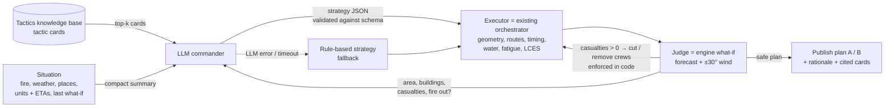

# LLM Commander with Tactics RAG — implementation plan

*FireTrace agents · 2026-10-21 · status: proposal*

**Goal.** An LLM becomes the incident commander: at each decision point it reads the situation, retrieves the
firefighting tactics that fit it, and chooses the **strategy** for plans A and B. The existing code keeps doing
the **execution** (geometry, routes, timing, water, fatigue) and the **safety** (zero predicted crew casualties).
Along the fight it re-plans when the situation changes.

**Done looks like:** on Penha and Falperra, the commander publishes plans A and B with a written rationale
that cites the tactics it used; both plans pass the zero-casualty rule on the forecast and on a ±30° wrong
wind; the result is at least as good as today's rule-based plans (houses first, then area); and if the LLM is
unavailable the service falls back to the rule-based plans without failing.

---

## 1. Starting point (what exists and stays)

| Layer | Today | With the commander |
|---|---|---|
| Situation | `situation_from_simulation`, `/summary`, `/vectors`, `/threatened`, fire clock | Same, plus a compact text/JSON summary for the LLM |
| Strategy | Fixed rules: plan A = attack, plan B = defend houses (`alternatives.py` options) | **The LLM chooses** the strategy from a fixed menu |
| Tactics | Rules in `orchestrator.py` / `firefighter.py`: initial attack, flanks, wet lines, fuel strips, early air attack, house zones, reserve | Same code, driven by the LLM's choices |
| Execution | Sectors, safe placement, routing, duty cycles, aircraft rotations, daylight | Unchanged |
| Safety | `judge.py`: what-if on forecast + ±30° wind, crews cut or removed until 0 casualties | Unchanged, and **never** delegated to the LLM |
| Re-planning | `adaptation.py`: every 45 min, a wave tries "attack" then "defend" | **The LLM chooses** each wave's strategy |
| Revisions | `revision.py`: PATCH of selected/active plans | Same, with the commander's rationale |

The rule-based planner stays as the **fallback** and as the **baseline** the commander is measured against.

## 2. Architecture



1. **Situation summary**: a short, deterministic JSON built from the backend (no geometry).
2. **Retrieval**: the tactic cards whose conditions match the situation (filters + embeddings).
3. **Commander**: one LLM call returns a strategy for plan A and one for plan B (structured output).
4. **Executor**: `run_cycle(...)` with the strategy turned into its parameters.
5. **Judge**: the existing what-if checks; casualties are removed by code, not by the LLM.
6. **Review** (optional, at most one round): the commander sees the judged numbers and may adjust once.
7. **Publish**: plans carry the rationale and the ids of the cards used (`metadata["agents.commander"]`).

## 3. Tactics knowledge base (the RAG)

### 3.1 Tactic cards, not raw manuals

The base starts with **30–60 short tactic cards** written in YAML (`agents/tactics/*.yaml`). Short, structured
cards retrieve better than chunks of PDFs, and their conditions can be filtered exactly.

```yaml
id: anchor-and-flank
title: Anchor and attack the flanks
when:                       # conditions the retriever filters on
  head_intensity_kwm: {min: 4000}          # head too strong for direct attack
  flank_intensity_kwm: {max: 4000}         # flanks still workable
  resources: [engines, crews]
do: >
  Anchor at a safe point (road, burned ground, rock), attack both flanks towards the head
  from the black, keep the head for aircraft or for a line ahead.
avoid: Attacking the head of a crown run; working above the fire on a slope.
safety: LCES; escape route to the black; lookout on the flank.
maps_to:                    # which strategy fields this card supports (section 4)
  mode: contain
  ground: flank_direct
evidence: >
  FireTrace test, Penha new physics: flank attack allowed by direction-aware suppression.
source: "ANEPC operational doctrine (to cite), LCES"
```

### 3.2 Initial card list (MVP)

| Area | Cards |
|---|---|
| Size-up | attack-to-extinguish vs contain; direct-attack limits by intensity (hand crews ~350 kW/m, engines ~1 700, machines ~4 000); crown-fire signs |
| Ground attack | direct head attack (weak fire); anchor-and-flank; parallel attack; indirect wet line ahead; fuel strip ahead; mop-up |
| Aircraft | early air attack on the head before crowning; aircraft concentrated on the head corridor (FireTrace lesson); day-only operations; rotations and refill distance |
| Structures | structure triage (defensible / not); prepare-and-leave defence; engines per patch of houses |
| People | evacuate vs shelter in place; evacuation timing margin; vulnerable groups first |
| Time of day | contain by day, attack at night/dawn when humidity rises; aircraft stop at sunset |
| Resources | reserve only when containing; pre-positioned crews; reinforcements that arrive too late do not count |
| Safety | LCES; trigger points to withdraw; never above the fire on a slope |
| Lessons learned | each tested FireTrace result as a card (e.g. "plan B defending the whole run saved 37 vs 52 buildings on Penha") |

Doctrine cards must cite their source (ANEPC / DECIR documents, LCES). Lessons-learned cards cite the FireTrace
run that produced them.

### 3.3 Retrieval

- **Filter** by the numeric conditions (`when`) against the situation summary.
- **Rank** the survivors by embedding similarity between the situation summary and the card text.
  Any embedding model works (e.g. the provider's embeddings, or an open model such as Nemotron Embed);
  embeddings are computed once at start-up and cached on disk.
- **Top-k = 6–8 cards** go into the prompt. With ≤ 60 cards the whole base would also fit in the prompt:
  retrieval matters once the base grows (full manuals, incident reports).

## 4. The commander's decision: a strategy menu

The LLM never writes coordinates, routes or times. It chooses from parameters the executor already understands.

```json
{
  "assessment": "Head crowning by T+30; flanks workable; 105 buildings in the path over 4 h.",
  "plans": [
    {
      "variant": "A",
      "intent": "save area",
      "mode": "auto",                    // auto | attack | contain
      "house_zones": 4,                  // patches of houses defended
      "defend_whole_run": false,         // all houses reached in the run, or only the first
      "engines_per_zone": 3,
      "fuel_breaks": true,               // squads open strips ahead where they finish in time
      "aircraft": "head_corridor",       // head_corridor | timed_with_crews | houses
      "reserve_share": 0.0,              // only applied when containing
      "concentration": 6,                // stretches of front the barrier metres go to
      "cards": ["early-air-attack", "anchor-and-flank", "fuel-strip-ahead"],
      "rationale": "…two or three sentences the operator reads…"
    },
    { "variant": "B", "intent": "save houses and people", "…": "…" }
  ]
}
```

| Field | Executor parameter | Exists today |
|---|---|---|
| `mode` | `initial_attack` decision (auto = current physics test; contain = force containment) | auto only → add an override |
| `house_zones` | `building_zones` | yes |
| `defend_whole_run` | `defend_whole_run` | yes |
| `engines_per_zone` | `defenders_per_zone` | yes |
| `fuel_breaks` | `fuel_breaks` | yes |
| `aircraft` | `air_support` + early air attack; `houses` = new small option | partly → add `houses` |
| `reserve_share` | `reserve_share` (+ `lean`) | yes |
| `concentration` | `concentration` | yes |

The response is validated with a JSON schema (provider structured output when available, otherwise
parse-and-validate with one retry). Values are clamped to safe ranges; unknown card ids are dropped.

## 5. Decision loop and re-planning along the fight

**Decision points:**

1. **T+0** (the baseline finishes): the commander chooses plans A and B.
2. **Every re-plan step** (today 45 min, `AGENTS_REPLAN_MINUTES`), on each plan's what-if: the commander chooses
   the wave's strategy instead of the fixed "attack, then defend" order in `adaptation._try_wave`.
3. **Event triggers** (a decision earlier than the step):
   - the fire crosses a line or reaches a patch of houses (`/threatened`);
   - wind shift in the weather series (direction ±30°, speed +50%);
   - night window opens: humidity rising, intensity below the direct-attack limit (`/summary`);
   - sunset: aircraft stop (`daylight.py`);
   - reinforcements or aircraft arrive (mobilization times).
4. **Operator revisions**: when the operator selects or edits a plan, `revision.py` asks the commander
   for the revision (PATCH) with the operator's change as an extra constraint.

**Per decision:** situation summary → retrieval → one LLM call → executor → judge → (optional) one review call
→ keep the wave only if the judge says it helps and stays casualty-free (today's rule in `adaptation._helps`).

## 6. Plans A and B

- The commander returns **two strategies with different intents** in the same call: A = save area
  (extinguish), B = save houses and people (defend). The prompt states the priority order every plan must keep:
  1) lives (crews and evacuees), 2) houses, 3) burned area.
- Each plan's summary shows the commander's rationale and the cited cards; the combat timeline and metrics in
  the frontend stay as they are.
- Optional: publish the rule-based plan as a third, hidden reference so the commander's gain is measurable.

## 7. Safety and guardrails

- **Zero casualties stays in code**: `judge.make_safe` runs on every plan the commander produces. A plan that
  still predicts a casualty is never published.
- **Menu only**: the LLM chooses parameters; it cannot invent units, places or geometry.
- **Validation + clamping** of every field; a bad response → one retry → rule-based fallback.
- **Timeouts**: 90 s per LLM call; on timeout or provider error the rule-based strategy is used and the plan says so.
- **Determinism for the demo**: low temperature; the commander's decisions are stored with the plan, so a
  rerun can replay them without calling the LLM.
- **Audit log**: prompt (situation + card ids), response and judged result per decision, in
  `metadata["agents.commander"]` and in the service log.
- **Data**: only aggregated, non-personal data goes to the provider (no names, no addresses).

## 8. Integration

**New modules** (`agents/firetrace_agents/commander/`):

| Module | Role |
|---|---|
| `tactics.py` | Load and validate the tactic cards (`agents/tactics/*.yaml`) |
| `retrieval.py` | Condition filter + embedding ranking (cached embeddings) |
| `situation_brief.py` | Deterministic compact situation summary for the prompt |
| `schema.py` | Strategy JSON schema, validation, clamping, mapping to `run_cycle` kwargs |
| `llm.py` | Thin provider client (OpenAI-compatible API), timeouts, retries |
| `commander.py` | Prompt, decision, review round, fallback |

**Changes to existing code:**

- `alternatives.build_alternatives`: options for A/B come from the commander (fallback: today's options).
- `adaptation._try_wave`: the wave's strategy comes from the commander.
- `orchestrator.run_cycle`: add the `mode` override and the `aircraft="houses"` option.
- `revision.py`: pass the operator's change to the commander.
- `watcher.py`: settings below.

**Configuration** (`docker-compose.yaml`, values from a local `.env` that is **never committed**):

| Variable | Meaning |
|---|---|
| `AGENTS_COMMANDER` | `llm` or `rules` (default `rules`) |
| `AGENTS_LLM_BASE_URL` | Provider endpoint (OpenAI-compatible) |
| `AGENTS_LLM_MODEL` | Exact model id from the provider's dashboard (to confirm) |
| `OPENAI_API_KEY` | Provider key: only in `.env` / the environment |
| `AGENTS_LLM_TIMEOUT_S` | Per-call timeout (default 90; decisions take ~25–40 s) |
| `AGENTS_TACTICS_DIR` | Tactic cards directory (default `agents/tactics`) |

## 9. Evaluation

Run on the two reference baselines (Penha `sim-4e5ac84b4b`, Falperra `sim-f62d0cd44f`), commander vs rules:

| Metric | Bar |
|---|---|
| Predicted crew casualties (forecast + ±30° wind) | 0, always |
| Buildings affected | ≤ rule-based (priority 2) |
| Burned area | ≤ rule-based + 5% (priority 3) |
| Fire out by end of run | reported |
| Valid strategy JSON on first try | ≥ 95% |
| Fallback rate | reported |
| Rationale cites ≥ 2 cards that match the situation | manual check |

Each run is logged (situation, cards, decision, judged result) so failures can be traced to a card or a prompt.
New lessons from these runs become cards.

## 10. Cost and latency

| Item | Estimate |
|---|---|
| Prompt per decision | ~3–5k tokens (situation ~1k, 6–8 cards ~2–3k, instructions ~1k) |
| Response | ~0.5–1k tokens |
| Decisions in a 4 h run | T+0 + ~3–5 waves per plan ≈ 6–11 calls (+ review rounds) |
| Decisions in a 12 h run | ~15–20 decision points ≈ 30–40 calls |
| LLM latency | seconds per call |
| Engine what-ifs | **the real cost in time**: 1–6 min each, ×3 with the wrong-wind check |

The LLM is cents per incident for small/cheap models; the engine simulations dominate wall-clock time.
Exact per-token prices: check the provider's pricing page for the chosen model.

## 11. Milestones (to the submission, 2026-10-23 16:30 UTC)

| When | Milestone | Done when |
|---|---|---|
| Day 1 morning | Tactic cards v1 (~30) + loader + retrieval | Cards validate; top-k makes sense for Penha and Falperra |
| Day 1 afternoon | Strategy schema + mapping to `run_cycle` + `mode`/`aircraft` options | Hand-written strategies produce the expected plans |
| Day 1 evening | Commander call (T+0) with fallback | A and B published from the LLM on both scenarios |
| Day 2 morning | Waves driven by the commander + evaluation run | Metrics table filled, commander ≥ rules on houses |
| Day 2 midday | Rationale and cited cards in the plans panel; demo freeze | Demo runs end to end; fallback tested with the key removed |

If time runs short, ship T+0 only (waves keep the rule-based order).

## 12. Risks and open questions

- **Model id** for "ChatGPT Luna": confirm the exact API model id in the provider dashboard.
- **Quality of choices**: the LLM may pick worse strategies than the rules → measured against the rules;
  fallback and the judge keep plans safe.
- **Latency of the review round**: each round costs a full what-if (minutes) → at most one round.
- **Doctrine sources**: which ANEPC / DECIR documents can be cited in the cards (licensing, language).
- **Portuguese output**: rationale in European Portuguese, checked on both scenarios.
- **Reproducibility**: store the commander's decisions with the plan so the demo can replay them offline.
