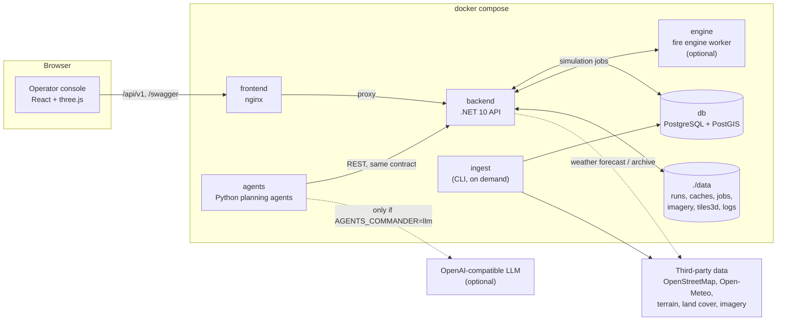
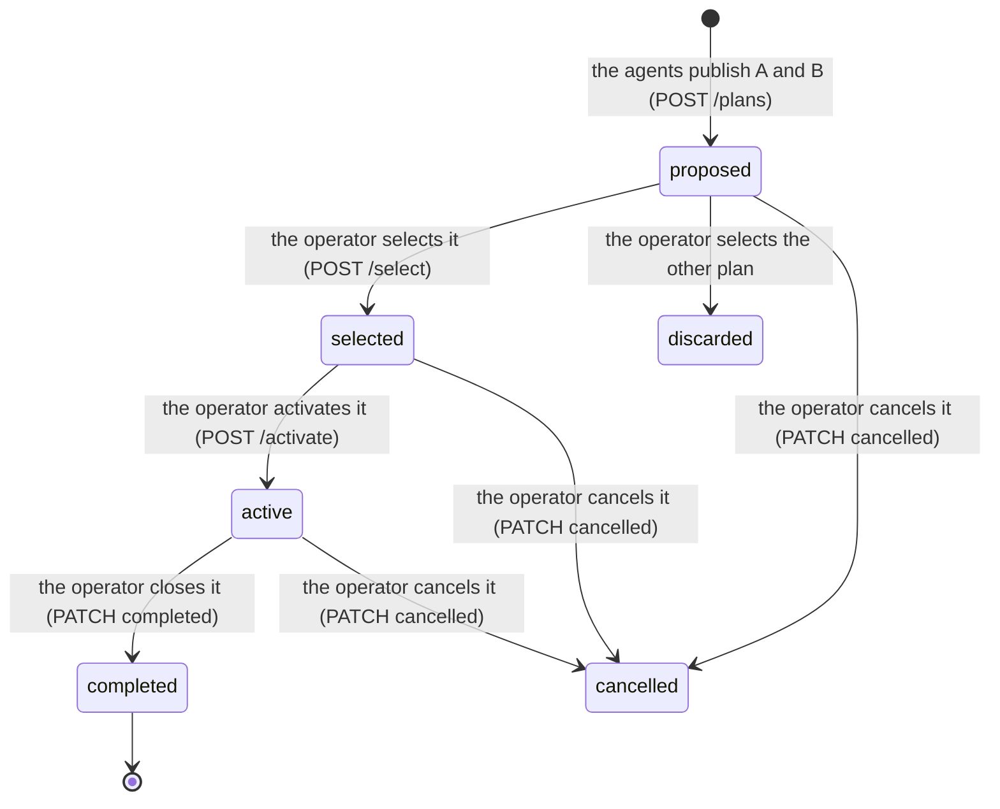
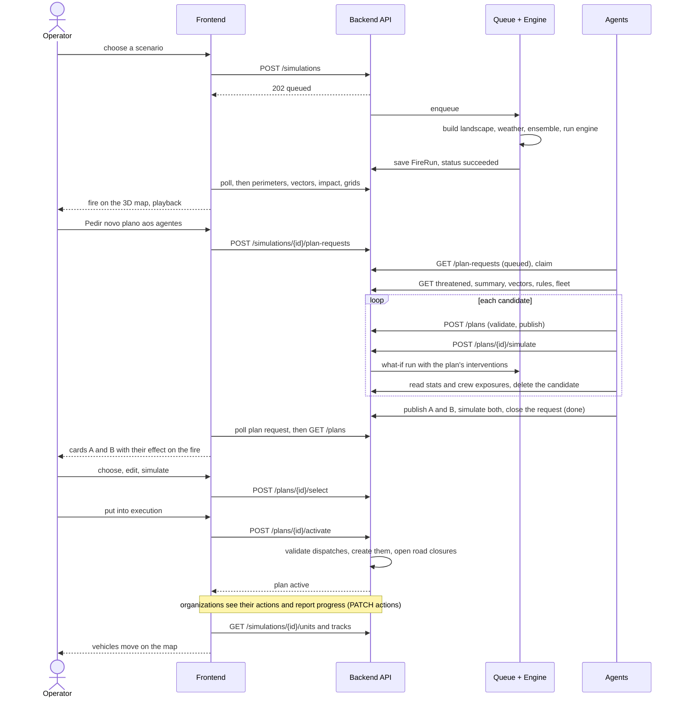

# Escudo Floriano (FireTrace) — Architecture

> Describes the code on `main` at commit `60dc69e` ("Merge agents-plan into main", 23 Oct 2026).
> The product is called **Escudo Floriano**; the code, the API and the namespaces are still called **FireTrace**. They are the same system.
> Facts below come from reading the repository, not from memory. Where something was *measured* rather than *read*, the text says so (section 14).

## Contents

1. [What the system is](#1-what-the-system-is)
2. [The system at a glance](#2-the-system-at-a-glance)
3. [Repository layout and how the team works](#3-repository-layout-and-how-the-team-works)
4. [The contract (`api-spec/openapi.json`)](#4-the-contract-api-specopenapijson)
5. [Backend (.NET 10)](#5-backend-net-10)
6. [How a simulation runs](#6-how-a-simulation-runs)
7. [The fire engines](#7-the-fire-engines)
8. [External data and the ingest](#8-external-data-and-the-ingest)
9. [Plans, decisions and execution (backend side)](#9-plans-decisions-and-execution-backend-side)
10. [The planning agents (`agents/`)](#10-the-planning-agents-agents)
11. [Frontend](#11-frontend)
12. [Deployment and configuration](#12-deployment-and-configuration)
13. [End to end: from a fire to an executed plan](#13-end-to-end-from-a-fire-to-an-executed-plan)
14. [Known limitations and observations](#14-known-limitations-and-observations)
15. [Testing and quality gates](#15-testing-and-quality-gates)
16. [Glossary](#16-glossary)
17. [Where to look in the code](#17-where-to-look-in-the-code)

---

## 1. What the system is

A **decision-support console for rural wildfire response in Portugal**. The pilot area is the municipality of Guimarães. It helps the people who decide
(GNR, PSP, Bombeiros, INEM and Proteção Civil) answer three questions:

1. **Where is the fire going?** — a physical fire-spread simulation over real terrain, vegetation, roads and weather.
2. **What should each organization do?** — two candidate response plans, **A** and **B**, proposed by software agents.
3. **What happens if we do that?** — every plan can be simulated ("what-if") against the same fire before anyone commits to it.

The idea, in four sentences (from the contract's own description):

1. Each organization registers its **resources** (stations, vehicles, personnel, equipment).
2. Anyone defines a **scenario** (ignition point, weather that can change over time, resources available) and runs a **simulation**.
3. An **agent** reads the fire, the resources, the roads, the water and the weather, and publishes **two plans, A and B**, made of per-organization **actions**
   (send vehicles, close a road, evacuate, …). They are starting points for the operator, not orders.
4. The **operator** picks one, adjusts it and **activates** it. Organizations execute their actions and report progress. Actions **change the fire**
   (firefighters holding a line in one spot really slow the spread there).

The guiding rule for the agents is: **the agents propose; physics and validation dispose.** An agent never guesses whether an action works. It publishes,
asks the backend to simulate it, and reads the answer.

The system has no user accounts and no event channel. Clients poll (`?updatedAfter=`).

---

## 2. The system at a glance



| Service | Technology | Port | What it does |
|---|---|---|---|
| `db` | `postgis/postgis:16-3.4` | host `5440` → `5432` | Two kinds of data: the API's own documents (plans, simulations, resources…) and the map of each location (terrain, roads, places…). Volume `pgdata`. |
| `backend` | .NET 10 | `8080` (`/swagger`) | The API. All the application logic, the simulation queue, the native fire engine. Reads `./locations`, `./api-spec` (read-only) and writes `./data`. |
| `engine` | Python + ELMFIRE (Fortran) | `9000` (internal) | An alternative, slower, more detailed fire engine. Only used when `FireTrace:Engine:Provider = elmfire`. The container is started by compose either way. |
| `ingest` | the backend image, target `ingest` | — | Command line that downloads a location's third-party data once. Compose profile `ingest`; also runs automatically in the background on first start. |
| `agents` | Python 3.12 | — | The planning agents. A service that polls the API and publishes plans. No port. |
| `frontend` | React/Vite built, served by nginx | `8081` | The operator console. nginx also proxies `/api/` and `/swagger` to the backend and serves local 3D city tiles under `/tiles3d/`. |

Two Docker networks: `firetrace-network` (everything) and `firetrace-proxy` (`172.30.250.0/24`, only nginx and the backend).
nginx has a fixed address on the proxy network; the backend trusts `X-Forwarded-For` **only** from that address (used for rate limiting, section 5.6).

---

## 3. Repository layout and how the team works

```text
backend/        .NET 10 API + fire engines + external data        (FireTrace.Core / .Engine / .ExternalData / tests)
frontend/       React + TypeScript + three.js operator console
agents/         Python planning agents (multi-agent system, MAS)
engine/         Python HTTP worker around ELMFIRE (the optional engine)
api-spec/       openapi.json — THE contract all of the above must agree with
locations/      one JSON per pilot area: map extent, curated facilities, example fires
data/           runtime: simulation results, caches, ELMFIRE jobs, agent logs (git-ignored, see section 14)
docs/           IMPROVEMENT_PLAN.md (audit), this file
tools/          fetch_tiles3d.py (one-time download of 3D city tiles)
.claude/skills/ firetrace-api-standard (the contract rules, for AI coding agents)
AGENTS.md  CLAUDE.md  PROTOCOL.md      rules for people and AI coding agents working in the repo
docker-compose.yaml  .env.example
```

**Four verticals, one contract.** `engine/`, `backend/`, `frontend/` and `agents/` are worked on by different people. Rules in `AGENTS.md`/`PROTOCOL.md`:

- **Contract first.** Nobody defines the API by what they happen to implement. `api-spec/openapi.json` defines it; the backend, the frontend and the agents are all
  clients of that file. A contract change goes through a proposal ("Contract Change Packet") and is applied in lockstep to the spec, the backend DTOs and the generated frontend types.
- **Stay in your vertical.** Other verticals and the spec are read-only unless the person running the session authorizes it.
- **The earliest split.** When two verticals fail to talk, find the first point where the payload differs from the spec (REST boundary) or from the `/jobs/<id>` files
  (engine seam), and report it rather than editing the other side.
- **Each vertical has its own `AGENTS.md`** with its technical rules (`backend/AGENTS.md`, `frontend/AGENTS.md`, `agents/AGENTS.md`, `engine/AGENTS.md`).

---

## 4. The contract (`api-spec/openapi.json`)

OpenAPI 3.1, base path `/api/v1`, written in Portuguese. About 70 paths (71 counted in the file), grouped by tag:

| Group | Tags | What it is |
|---|---|---|
| **Resources** | Locations, Terrain, Organizations, Stations, Vehicles, Personnel, Equipment, Resources, Road Closures, Weather, Scenarios | The map and everything with state that is created, read, updated and deleted. All have `id` and `updatedAt`. |
| **Simulation and analysis** | Simulations, Results, Routing | Asynchronous calculations and their read-only results. |
| **Decisions** | Dispatches, Plans, Actions | Sending resources with people and responsibility, and the A/B plans the operator picks and organizations execute. |
| **Meta** | `/health`, `/capabilities`, `/rules` | Liveness, what the server really implements, and the operational parameters (speeds, water, crew rates, safety distances…). |

Largest path families: `/simulations` (17), `/locations` (16), `/plans` (8), `/dispatches` (4), `/vehicles`, `/plan-requests` (3 each).

**Conventions** (the same for every endpoint):

| Topic | Rule |
|---|---|
| Names | JSON fields `camelCase`; enum values `snake_case`; ids are opaque strings. |
| Time | RFC 3339 with time zone. Inside a scenario a `TimeSpec` is **either** `offsetMinutes` from the start **or** an absolute `time`. Poll changes with `?updatedAfter=`. |
| Units | In the field name: `…Kmh`, `…C`, `…Pct`, `…M`, `…Ha`, `…Kwm`, `…Mmin`, `…Minutes`. Bearings in degrees, 0 = north. **Wind is "from"**: `windFromDeg` of a NW wind means air moving towards the SE. |
| Geometry | GeoJSON `[lon, lat]`. A single point uses `LatLon {lat, lon}` instead — deliberately different. |
| Lists | Cursor pagination: `?limit=` (max 200) and `?cursor=`, response `{items, nextCursor}`. Multi-value filters are comma separated. |
| Partial updates | `PATCH` with `application/merge-patch+json` (RFC 7396). |
| Errors | `application/problem+json` (RFC 9457) with a stable `code` and `errors[]`. Branch on `code`, never on the message. |
| Long operations | A simulation answers `202` with `status: queued`; poll `GET /simulations/{id}`. `Prefer: wait=<s>` asks for a synchronous answer if it finishes in time. |
| Evolution | Optional fields are not breaking; **clients must ignore unknown fields**. Every resource has free `tags` and `metadata`. A new action kind can start as `type: custom`. |
| Ahead of the engine | `GET /capabilities` says what is really implemented. Asking for what is not returns `422 unsupported_capability`. |

**How the contract is kept honest**

- Backend: `EndpointCoverageTests` and `ContractTests` check every route and every `example` of the spec against the controllers and DTOs, with unmapped members disallowed.
- Frontend: `src/api/schema.ts` is **generated** with `openapi-typescript` and never edited by hand.
- Agents: `contracts.py` loads the spec and `validate_against_spec` checks every payload before it leaves.

---

## 5. Backend (.NET 10)

### 5.1 Projects and dependency rules

```text
FireTrace.Engine         Runs a fire. Native C# engine or the ELMFIRE container, plus caching and storage of finished runs.
FireTrace.ExternalData   Everything from third-party APIs. Fetched once, stored locally (PostGIS + files), read from there. Also the `ingest` command line.
FireTrace.Core           The API: controllers, services, repositories, domain. Uses the other two.
tests/FireTrace.Tests    Unit, API and architecture tests.
```

`Engine` and `ExternalData` know nothing about `Core`, nor about each other. Only `Core` looks at the other two. An architecture test fails the build if that changes.

Inside `FireTrace.Core`:

| Folder | What lives there |
|---|---|
| `Controllers/` | HTTP only: bind the request, call **one** service, return the result. No logic. |
| `Services/<Area>/` | The application logic by area: `Fire`, `Operations`, `Resources`, `Routing`, `Weather`, `Map`, `Crud`, `Policies`, `Meta`. |
| `Repositories/` | The only code that stores or loads things (PostgreSQL documents, run files). Services depend on interfaces. |
| `Domain/<Area>/` | Persisted entities and value objects (records and enums). |
| `Models/<Area>/` | Request/response shapes that are not persisted. |
| `Configuration/` | Typed settings bound from `appsettings.json`. No tunable value is hidden in code. |
| `Hosting/` | Composition root (`ServiceCollectionExtensions`), `Bootstrap`, `SimulationWorker`. |
| `Middleware/` | `ProblemMiddleware` (problem+json), `DatabaseReadinessMiddleware`. |

**Rules enforced by tests** (`tests/FireTrace.Tests/Architecture`):

- One top-level type per file, named like the file.
- No side effects in the logic: time comes from `TimeProvider`, ids from `IIdGenerator`, randomness from an explicit seed; no `File`/`Environment`/`Console`/`Process` in the logic; no static mutable collections; configuration only through typed settings.
- Dependencies point inwards: `Domain ← Models ← Repositories/Services ← Controllers`.
- Controllers never touch `IDocumentStore<`, `Npgsql`, `IMapReader` or `IFireEngine`.
- Every route and example in the spec has a controller and a DTO.

### 5.2 Where data lives

| What | Where | Notes |
|---|---|---|
| The API's own state: organizations, stations, vehicles, personnel pools, equipment, scenarios, simulations, plans, plan requests, dispatches, road closures | PostgreSQL table `documents(collection, id, body jsonb, created_at, updated_at)` | One table for all types; the collection is the type name (`PgDocumentStore<T>`). Filters run in memory over hundreds of items. Migration `001_api.sql`, tracked in `api_schema_migrations`. |
| The map of each location: terrain and land-cover grids, road graph, places, facilities, water points, waterways, firebreaks, imagery, weather observations | PostGIS tables, written by the ingest, read through `IMapReader` (`CachedMapReader`) | Migrations `001`–`008` in `FireTrace.ExternalData/Store`, applied by `SqlMigrator`. |
| Finished simulations (the grids) | `data/runs/<id>/` | Compact binary grids plus a small JSON (`FileRunStore`). Recently read runs are kept in memory (`CacheCapacity: 8`). |
| Engine result cache | `data/engine-cache/` | A job already computed is answered from disk. Key: a hash of everything that decides the result (`FireJobFingerprint`). |
| ELMFIRE working folders | `data/jobs/<id>/` | Inputs and outputs of the engine seam (section 7.3). |
| Imagery, ortho, 3D tiles | `data/imagery/`, `data/cache/`, `data/tiles3d/` | Downloaded once. |
| LLM audit log | `data/agents-logs/` | One JSON line per LLM call. |

### 5.3 Start-up (`Bootstrap`)

The web server starts listening **before** the database is ready; `Bootstrap` (a background service) then does, with retries and back-off:

1. Migrates the map schema and the API schema.
2. `ScenarioSeeder`: turns the example incidents of `locations/*.json` into `builtin` scenarios (the frontend's start list).
3. Makes sure each location has its data: if none has terrain, it ingests the first one **before** declaring ready; the rest are ingested in the background
   (the optional steps `weather` and `ortho` are skipped).
4. `ResourceSeeder`: creates organizations, stations, vehicles, personnel pools, equipment and the demo road closure for each location.
5. Marks the database ready and **warms up**: queues one baseline simulation per example incident that does not have a successful result yet.

`DatabaseReadinessMiddleware` answers `503` for anything that needs the database until step 5, while `/health`, `/capabilities`, `/rules` and `/openapi.json` always answer.

`SimulationWorker` runs the queue **one simulation at a time**. On start it re-queues what was `queued` and marks what was `running` as `failed` ("the API restarted during the simulation").

### 5.4 Domain model

| Entity | Notes |
|---|---|
| **Location** | Not stored as a document: defined by `locations/*.json` (extent, grid size, cell size, curated facilities, example incidents) and loaded into PostGIS by the ingest. |
| **Organization** | A corporation (Bombeiros, GNR, INEM, Proteção Civil, …) with a type and a logo. |
| **Station**, **Vehicle**, **PersonnelPool**, **Equipment** | The resources. A vehicle has a type (forest/light/urban fire engine, tankers, command, ambulance, patrol, helicopter, …), capacities (crew, minimum crew, water), capabilities and a live `state` (status, position, water, crew, fuel). A personnel pool is a group of **unnamed** people ("forest firefighters of the Bombeiros: 75 free of 80"). |
| **Scenario** | Location, start, duration, ignitions, weather specification (including timed weather events), optional initial burned area, ensemble and engine options. |
| **Simulation** | `kind`: `baseline` or `what_if`. `status`: `queued → running → succeeded / failed / cancelled`. Keeps a **snapshot** of the scenario it ran, stats and (for a what-if) the plan id and the crew exposures. |
| **Plan** | `variant` A or B, strategy, summary, `basis` (scenario, simulation, situation time), objectives, alert level, horizon, **actions**, assumptions, validation result, status history. |
| **Action** | 15 types: `dispatch_units`, `stage_resources`, `establish_command_post`, `road_closure`, `traffic_control_point`, `evacuation`, `shelter_in_place`, `structure_protection`, `fire_attack`, `medical_standby`, `air_support_request`, `public_alert`, `request_reinforcements`, `reconnaissance`, `custom`. Each has an organization, resources, a trigger, a reason (`rationale`), an expected effect, safety notes and optional `simulationEffects`. |
| **PlanRequest** | The operator's request to the agents for a new plan pair (section 9.5). |
| **Dispatch** | A vehicle or a crew sent to a target with a number of people and a responsibility. Created by the operator, or in bulk when a plan is activated. |
| **RoadClosure** | A closed road section with kind, reason, exemptions (for example emergency vehicles), detour, checkpoints and a period. |
| **Rules** | The operational parameters (`GET /rules`): movement, refill, crew rates and fatigue, aerial limits, safety distances, suppression effectiveness. Read from `appsettings.json`, never hard-coded. |

State machines:

- **Plan:** `proposed → selected → active → completed`, plus `discarded` (another plan was chosen) and `cancelled`.
- **Plan request:** `queued → planning → simulating → done / failed`.
- **Dispatch:** `ordered, en_route, on_scene, working, refilling, resting, grounded, returning, completed, cancelled, failed`.

### 5.5 Services by area

| Area | Main pieces | Role |
|---|---|---|
| `Fire` | `SimulationService`, `SimulationQueue`, `LandscapeBuilder`, `BarrierSet`, `InterventionApplier`, `FireResults`, `FireAnalytics`, `SmokeService`, `SmokePlume`, `ScenarioSeeder` | Orchestrates a simulation; turns a stored run into perimeters, spread vectors, impact, threatened places, smoke. |
| `Weather` | `WeatherService`, `WeatherTimeline`, `Ensemble`, `ResolvedEnsemble` | Real weather (Open-Meteo archive/forecast) or a programmed weather curve with timed events; builds the ensemble members. |
| `Routing` | `RoutingService`, `RoadGraph`, `RoadCuts`, `RoadCutsCache`, `RoadStatusResolver`, `RoadSpeeds`, `RoadSlopes`, `TravelProfile` | Realistic routes and ETAs per vehicle type, respecting closures and the predicted fire. |
| `Operations` | `PlanService`, `PlanValidator`, `PlanRouter`, `PlanInterventions`, `PlanTiming`, `PlanRequestService`, `DispatchService`, `VehicleDispatcher`, `PersonnelDispatcher`, `OperationSimulator`, `CrewSafety`, `CrewWorkSchedule`, `ArrivalEstimator`, `TargetResolver` | The decision side: plan lifecycle, validation, what-if, dispatching, the unit simulator. |
| `Resources` | `ResourceSeeder`, `VehicleStateService`, `ResourceOverview` | Seeding and live state of resources. |
| `Map` | `MapQueries`, `Population` | Queries over the stored map. |
| `Crud` + `Policies` | `CrudService<T>`, `MergePatch`, one `*Policy` per entity | Generic create/read/update/delete with merge-patch, and per-entity validation (references exist, closure ends after it starts, …). |
| `Meta` | `CapabilityCatalog`, `MetaService` | `/capabilities` and `/rules`. |

### 5.6 Cross-cutting

- **Errors:** every failure is `application/problem+json` with a stable `code` (`validation_failed`, `resource_conflict`, `invalid_transition`, `unsupported_capability`, `resources_unavailable`, `internal_error`, …).
- **Rate limiting** (settings in `appsettings.json`, `Limits`): two per-IP windows. Calls from a private address on the container network (the agents) use the internal window (**6000/min**); everyone else gets **300/min**.
  `X-Forwarded-For` is honoured only from the nginx proxy address. The planning endpoints allow **6** in parallel (queue 64), plan requests have their own limiter (16, queue 64).
- **Configuration:** every tunable value is a key in `appsettings.json` (`Core`, `Engine`) or `externaldata.settings.json` (`ExternalData`); tests fail on a missing or zero value.
- **Documentation:** Swagger at `/swagger`, the spec at `/openapi.json`.

---

## 6. How a simulation runs

`POST /simulations` → `SimulationService.CreateAsync`:

1. Takes the scenario (by id, or inline), validates it (known location, duration within limits — at most 720 min —, 1 to 10 ignitions, ignitions inside the map), stores a **snapshot** of the scenario in the simulation, status `queued`, and enqueues it. Returns `202`.
2. `SimulationWorker` takes simulations **one at a time** and calls `RunAsync`, which moves it to `running` and reports progress: `preparing → running_members → post_processing → done`.

`ExecuteAsync` builds a **`FireJob`** for the engine:

| Step | What happens |
|---|---|
| **Landscape** | `LandscapeBuilder` combines the stored terrain/land-cover grids into 8 bands (elevation, slope, aspect, fuel model, canopy cover, canopy height, canopy base height, canopy bulk density) and, from roads, firebreaks and waterways, a per-cell **spread adjustment** (barriers). Built once per terrain and cached. |
| **Interventions** | The scenario's own, plus — through `IInterventionProvider` — the actions of a **plan** (for a what-if: `PlanInterventions`) and, if asked, the **active dispatches**. `InterventionApplier` turns them into fuel treatments, spread adjustments and **suppression windows** (timed, unless the engine is ELMFIRE, which applies everything from minute 0). |
| **Ignitions** | Snapped to the nearest flammable cell if they fall on urban, water or rock. |
| **Weather** | `WeatherService` builds the weather track for the period: Open-Meteo (ERA5 archive or forecast) or a programmed curve with timed events (rain, storm, wind change, humidity, temperature…). A spin-up period (7 h by default) warms the dead-fuel moisture model first. |
| **Ensemble** | A central run (`rep`) plus *N* perturbed members (default **12**, at most 24): wind speed ×0.75–1.25, wind direction σ 15°, humidity ×0.85–1.15, all from a fixed seed so results are reproducible. Barriers are recomputed per member for its strongest wind. |
| **Initial fire** | Optional: a burned perimeter to continue from. |

The job goes to `IFireEngine.RunAsync` (section 7). The result is a **`FireRun`**: for the central run and every member, a grid with the **minute each cell ignites** (the time-of-arrival grid), the fire-line intensity (kW/m) and crown-fire flags, plus the weather samples that were used.
It is saved by `FileRunStore`; the simulation gets its stats and becomes `succeeded` (or `failed` with a problem, never left `running`).
For a **plan's what-if**, `CrewSafety` also computes which crews are caught by the fire (`crewExposures`, `crewCasualties`).

Everything a client then asks for is **derived on demand** from the stored grids by `FireResults`: perimeters at a minute, spread vectors, the places and roads threatened, impact over time, road status, place access, smoke, summary and the raw binary grids. A what-if also exposes the **unit simulation** (`/simulations/{id}/units`, `/units/{unitId}/track`).

---

## 7. The fire engines

### 7.1 Composition

```text
IFireEngine  =  CoupledFireEngine( CachedFireEngine( provider ) )
provider     =  NativeFireEngine          (default, "native")
             |  ElmfireEngine             ("elmfire": files in /jobs + the engine container)
```

- **`CachedFireEngine`** answers a job that was already computed (same fingerprint) from disk instead of simulating it again.
- **`CoupledFireEngine`** couples the fire to the wind: it runs the central member alone, computes the wind that fire induces (convection), then runs all members with that wind — `1 + N` runs instead of `2N`.
- The provider is chosen by `FireTrace:Engine:Provider` (configuration, not a scenario field).

### 7.2 Native or ELMFIRE

| | Native (default) | ELMFIRE |
|---|---|---|
| Where | In process (C#), one task per member | Fortran, in the `engine` container, one job per simulation |
| Surface fire | Rothermel (1972) with the full Scott & Burgan 40 fuel models, size classes, live/dead moisture, wind adjustment factor | Rothermel + level-set PDE |
| Crown fire | Van Wagner initiation and active crowning | Crown fire and torching |
| Front propagation | Elliptical front by minimum travel time (Dijkstra) | Level set |
| Spotting | Not implemented | Yes |
| Rain, gusts, live moisture | Yes | Rain is not part of the `wx_<m>.csv` seam |
| Timed suppression | Yes | No (everything from minute 0) |
| Best for | Interactive what-if, plan comparison, ensembles | Independent validation, spotting research |

The decision (see `engine/ENGINE-COMPARISON.md`): **native is the default; ELMFIRE stays as the high-fidelity validation provider.**
Native physics lives in `FireTrace.Engine/Native/`: `FuelModelCatalog`, `RothermelSurfaceFire`, `WindAdjustmentFactor`, `FireBehaviorModel`, `MinimumTravelTimeSolver`, `SuppressionIndex`.
Weather and fuel moisture (Simard equilibrium, time lags, rain) are in `FireTrace.Engine/Weather/`.

### 7.3 The engine seam (`backend` ↔ `engine`)

`engine/runner.py` is a small HTTP worker on `:9000` (`POST /run {"job": "<id>"}`, `GET /progress/<id>`, `GET /health`). It does not speak OpenAPI.
The backend writes `/jobs/<id>` and reads the results back:

| In `/jobs/<id>` | Content |
|---|---|
| `meta.json` | grid size, cell size, duration, ignitions, members, spotting parameters |
| `landscape.i16` | 8 bands × h × w, int16 |
| `adj.f32`, `adj_<m>.f32` | spread adjustment (shared, and per member) |
| `phi0.u8`, `wind_<m>.f32` | optional initial burned area, optional wind field |
| `wx_<m>.csv` | `ws, wd, m1, m10, m100, lh, lw` per time step |
| **Out** `/jobs/<id>/<m>/` | `toa.i16` (minutes to arrival, −1 = unburned), `flin.u16` (kW/m), `crown.u8` (0/1/2), `log.txt` |

The file formats must change **in lockstep** on both sides: `FireTrace.Engine/Elmfire/ElmfireJobFiles.cs` and `engine/runner.py`. If any member fails, the whole simulation fails.

---

## 8. External data and the ingest

Third-party data is fetched **once per location**, stored locally, and read from there. A simulation never calls a third party, except for the weather.

| Data | Source | Ingest step (order) |
|---|---|---|
| Terrain (elevation) | AWS Terrain Tiles (Terrarium) | `terrain` (10) |
| Land cover / fuel | ESA WorldCover 2021, Copernicus HRL forest type | `landcover` (20) |
| Satellite imagery | EOX Sentinel-2 cloudless | `imagery` (30) |
| Orthophotos | DGT ortho 2021 (WMS) | `ortho` (40) |
| Roads | OpenStreetMap (Overpass) | `roads` (50) |
| Buildings | OpenStreetMap | `buildings` (60) |
| Places and facilities | OpenStreetMap + curated list in `locations/*.json` | `places` (70) |
| Water points, waterways | OpenStreetMap | `water` (80), `waterways` (85) |
| Firebreaks | GeoJSON | `firebreaks` (90) |
| Weather | Open-Meteo (archive and forecast) | `weather` (95) |
| Photoreal 3D city | Google Photorealistic 3D Tiles, via `tools/fetch_tiles3d.py` | `tiles3d` |

A location is a file in `locations/`: id, name, centre, grid size and cell size (for example 280×280 cells of 30 m), the weather point, imagery settings, **curated facilities** (fire stations, GNR, civil protection, INEM, hospitals — curated entries win over OSM, which covers GNR and Proteção Civil poorly) and its **example incidents**. Two locations ship: `guimaraes` (Penha detail, 8 km) and `guimaraes-concelho` (the whole municipality, 22 km).

Run it with `docker compose --profile ingest run --rm ingest --location guimaraes`. The backend also ingests missing locations by itself at start (section 5.3).

---

## 9. Plans, decisions and execution (backend side)

### 9.1 A plan and its life



Closing a plan is done only through `PATCH /plans/{id}` with `{"status": "completed"}` or `{"status": "cancelled"}`, and only on a plan that is `proposed`, `selected` or `active`.

- **Publish** (`POST /plans`): the plan is validated (`PlanValidator`: references to resources and organizations exist, dependencies have no cycles, resources are not double-booked, crew ranges, capabilities and responsibilities, smoke safety, fuel-break rules, inside the location, …). `PlanRouter` stores, for every ground vehicle of an action with a readable target, its own road route and `etaMinutes`.
- **Validate before publishing** (`POST /plans/validate`, `POST /dispatches/validate`): returns issues with a stable `code`, so a client can branch on them.
- **What-if** (`POST /plans/{id}/simulate`): creates a `what_if` simulation whose scenario is the baseline's, with the plan's actions translated into interventions by `PlanInterventions`.
  If an action carries `simulationEffects`, those are used; otherwise the effect is inferred from the action type and the resources assigned (people, vehicles, water).
- **Select** (`POST /plans/{id}/select`): the other still-proposed plans on the same basis become `discarded`. Nothing is sent yet; the operator can still edit (`PATCH`) and simulate.
- **Activate** (`POST /plans/{id}/activate`, only from `selected`): creates one **dispatch per vehicle or crew** (with people and responsibility) and opens the **road closures**. The actions appear in the organizations' task lists (`GET /actions`).
- **Close** (`PATCH` with `status: completed`): cancels the dispatches the plan created and lifts its closures.
- **Delete:** a plan can be deleted only while it is not, and has not been, in execution (`PlanPolicy`); one that ran stays as history.
- Organizations then report progress on each action (`PATCH /plans/{id}/actions/{actionId}`: planned → acknowledged → in progress → completed / blocked / failed).

### 9.2 Dispatching

`DispatchService` validates and creates dispatches through one `IResourceDispatcher` per resource type:

- `VehicleDispatcher`: duplicate vehicle in the batch, vehicle in service and free, crew within the vehicle's minimum and capacity, the responsibility supported by its capabilities.
- `PersonnelDispatcher`: enough free people in the pool (counted across the batch).
- `ArrivalEstimator` + `RoutingService`: a road route and an ETA to the target; an origin or target more than 500 m from any road is `target_unreachable`.

### 9.3 The unit simulator

`OperationSimulator` replays a plan minute by minute: each vehicle leaves its station, follows its **road** route, stops where the road ends (the crew continues on foot), works, goes to the fastest water point when its tank is empty, refuels, rests when it must (`CrewWorkSchedule`, `UnitDuty`), and does all the jobs the plan gives it, in order, before returning.
A ground vehicle with no road to its target does not leave (`failed`). It is deterministic and does not change the fire; its result is `GET /simulations/{id}/units` and `/units/{unitId}/track`, which the map plays back.

### 9.4 Safety

`CrewSafety` applies one rule: a crew standing on a cell that is burning (on the way or at work) is caught and loses a percentage per minute. Aircraft do not count.
The service only **evaluates** a plan against a fire; where to put the crews is the planner's job.

### 9.5 Plan requests

The operator asks for a new pair with **"Pedir novo plano aos agentes"** → `POST /simulations/{id}/plan-requests` (optional note and decision minute).
An agent claims the oldest `queued` request (`POST /plan-requests/{id}/claim`), reports each step (`PATCH`: composing → judging → publishing → simulating) and closes it `done` with the plan ids, or `failed` with the reason.
A claimed request that goes quiet is released after `PlanRequestStaleMinutes` (20) so another agent can take it. Only one plan request is processed at a time in the whole system.

---

## 10. The planning agents (`agents/`)

A Python package (`firetrace_agents`) that is **only a client of the API**. It runs as a service (`python -m firetrace_agents.watcher`) or from scripts.

### 10.1 The loop

1. **Watch** — every `AGENTS_POLL_SECONDS` (10) the watcher looks for `queued` plan requests, and (if `AGENTS_AUTO_PLAN=1`) for finished baselines with no plans.
2. **Sense** — `GET /simulations/{id}/threatened`, `/summary`, `/vectors`, `/road-status`, `GET /rules`, the live fleet. Never a guessed position.
3. **Decide** — the **orchestrator** builds the team from the live fleet and each agent proposes with a **reason**.
4. **Compose** — plans A and B are composed (`alternatives.py`).
5. **Judge** — each candidate is published, its what-if is simulated, its stats and crew exposures are read, and the candidate is deleted. Plan titles `[lab]` mark these throw-aways.
6. **Validate and publish** — `POST /plans/validate`, then `POST /plans`, then `POST /plans/{id}/simulate`.
7. **Clean up** — with `AGENTS_KEEP_ONLY_LATEST=1`, the older `proposed`/`discarded` plans of the same scenario (and their what-if runs) are deleted. Selected, active, completed and cancelled plans stay as execution history.

### 10.2 The agents

| Agent | Module | Decides |
|---|---|---|
| **Orchestrator** (command) | `orchestrator.py` | Builds the team, ranks the fire-front **sectors**, guards every proposal (tier matrix, `/capabilities`, resource conflicts), validates, publishes. |
| **Firefighters** | `firefighter.py`, `sectors.py`, `placement.py`, `capacity.py`, `duty.py`, `terrain.py`, `fuelbreak.py` | Which stretch of the front each unit works (the nearest units first, on the flanks and the back of a young fire as well as its head), where it stands safely (burned side of the edge, or just ahead of a weak edge while its own cell is safe; leave before the fire comes), how much it delivers given water and fatigue, and how slope and fuel change its effect. |
| **Proteção Civil** | `support.py`, `life.py` | Evacuate in time or shelter in place (vulnerable people first), shelters and routes, public alerts, the command post. |
| **GNR** | `gnr.py` | Closes the roads the fire cuts, **only with a patrol at every end** (a closure nobody enforces is no closure); emergency vehicles always pass. |
| **INEM** | `support.py` | Ambulances on standby behind the crews, hospitals on alert. |

Rules shared by all (they have tests in `tests/test_realism.py`, `tests/test_cordon.py`): task forces of at most 3 crews per spot, sectors read 30 min ahead, all around the fire, drives never cross burning ground, crews hold in the field instead of going home, joint operations linked through `supportingOrganizationIds`.

### 10.3 Plans A and B

Both follow the same priorities: **1. lives (crews and people evacuated), 2. houses, 3. burned area.**

- **A — offensive:** every unit that can work safely attacks; aircraft prepare the ground just before the crews go in; fuel breaks ahead where there is time; the houses the fire reaches first are defended.
- **B — defensive:** people and houses first; part of the force waits forward as a reserve when the fire must be contained.

**The safety rule (`judge.py`): a plan that predicts a crew casualty is never published, A or B.** Each plan is judged on the forecast and on two runs with the wind wrong by 30° either way. Crews caught have their stay cut or are not sent.

### 10.4 Keeping the plan right over time

- **Re-planning** (`adaptation.py`): every `AGENTS_REPLAN_MINUTES` (45) the agents read the plan's what-if; if the fire is not under control they decide again with the free units, keeping a wave only if the engine says it helps and keeps zero casualties.
- **Holding** (`holding.py`): units that finish their job stay in the field (`stage_resources`) at a spot clear of every judged fire, instead of being sent home by the unit simulator.
- **Revisions** (`revision.py`): when the operator selects or edits a plan, the agents re-check it and revise it with `PATCH`.
- **Travel** (`travel.py`): each unit's arrival comes from `POST /routing/route`; a unit with no route is not assigned; units that cannot reach the fire go as near as is safe (300 m to 6.4 km out) and wait.
- **Campaigns** (`campaign.py`): rolling-horizon forecast → plan → execute → next state, used by the experiment scripts.

### 10.5 The LLM option

`AGENTS_COMMANDER=llm` (with `OPENAI_API_KEY` and `AGENTS_LLM_MODEL`) adds **one more candidate plan** that the engine judges exactly like the rule-based ones; the better one ships. Without a key or model, the rules decide.

- `commander/`: a tactics base (cards with engine facts, doctrine and lessons) from which a brief of the current fire selects the relevant ones; an LLM commander chooses the plan's strategy.
- `llm/`: a LangGraph with one advisor per organization (Bombeiros, Proteção Civil, GNR, INEM) and a commander's review. `advisor.py` defines the contract: the model **only chooses among options the rules showed it** (by id). It never writes ids, coordinates or action JSON, and a choice that breaks a hard rule is sent back with what was wrong, then discarded.
- Every call can be logged for audit (`AGENTS_LLM_LOG_DIR`).

The doctrine in `llm/prompts.py` and the assumptions in `terrain.py`, `life.py`, `capacity.py` are **starting points to validate with the corporations**.

### 10.6 Seeding on start

With `AGENTS_SEED_DEMO=1` (default) the service registers a maximum-alert day's demo resources (aircraft, pre-positioned crews, reinforcement groups from neighbouring districts) by running `scripts/seed_air_and_prepositioning.py` and `scripts/seed_reinforcements.py`, which skip what already exists.

### 10.7 Tests

`pytest agents`: contract and logic tests against `httpx.MockTransport` (no live backend). The LLM tests use a scripted stand-in for the model and need the `llm` extra.

---

## 11. Frontend

React 18 + TypeScript + Vite. The interface is in Portuguese. It talks to the backend **only** through the typed axios layer in `src/api`.

### 11.1 Layers (dependencies point downward)

| Layer | Folder | Responsibility |
|---|---|---|
| UI | `components/` | React components. No I/O and no three.js objects. `layout/` shell (TopBar, PlaybackBar, shortcuts), `panels/` side tabs, `viewport/` map overlays, `resources/` the Recursos view, `common/` shared bits. |
| Hooks | `hooks/` | Glue: bootstrap, world lifecycle, per-frame loop, store→GPU sync, simulation actions, units and people sync. |
| Use cases | `usecases/` | Pure async compositions of API calls: load a location, load a run. |
| State | `store/` | One Zustand store (`appStore`) plus `resourcesStore`. Components subscribe to narrow selectors. |
| GPU engine | `engine/` | three.js. `SceneEngine` (renderer, camera, orbit controls, loop), `World` (terrain and all layers), the fire GLSL. Knows nothing about React or HTTP. |
| Domain | `domain/` | Pure logic: georeferencing, colour ramps, weather interpolation, impact model, action timing, plan editing, form → request mapping. |
| API | `api/` | `httpClient` (one axios instance), `pagination`, `binaryGrids`, one service per resource, generated `schema.ts`. |

### 11.2 The screen

`App` = `TopBar` + (`Viewport` + `SidePanel`) + `PlaybackBar`; the **Recursos** tab replaces the map with the resource editor.

| Tab | Content |
|---|---|
| **Incidente** | The scenario, milestones, layer/view options, and a form to run a simulation with other weather (a programmable weather curve and timed events). |
| **Planos** | Ask the agents for a plan pair; plans A and B with their effect on the fire; select, activate, close; the plan's actions and timeline; the editor to adjust a plan. |
| **Estradas** | Where the response comes from (a selector that changes the access times), the roads cut at the current minute, and the places that lose access, with their population. |
| **Meios** | The location's facilities by kind (fire stations, GNR, civil protection, INEM, hospitals…) with their data source and confidence, plus the water points and the largest water bodies. |
| **Meteo** | Weather of the run (wind, temperature, humidity, charts). |
| **Recursos** | Organizations register stations, vehicles, personnel and equipment. |

The `PlaybackBar` is the simulated clock: play, speed, scrubbing, a weather timeline where events can be added or removed.

### 11.3 How the map is drawn

The CPU uploads a result **once per simulation** (the ignition-time grid as a float texture). Each frame it sets one `fireTime` uniform; flame shape, flicker and colour are computed per pixel in `fireShader`/`burnShader`. Smoke is a shader-drawn point-sprite system, roads are one vertex-coloured mesh, arrows are instanced.
`World` owns the layers: terrain, roads, assets, water, **plan** (fire lines, aerial drops, crew zones, closures, evacuation), fire, flames, wind, smoke, units, fleet, people, ensemble cone, aftermath, rain/clouds/storm, and the optional photoreal 3D city. React only ever calls `World`'s methods.
Time lives in the store; React re-renders only the few components that show the current minute.

### 11.4 Data flow

```text
useBootstrap     → location catalog + the chosen location's static map data          (?loc=)
useWorldLoader   → builds the GPU World once engine + data exist
App              → selects the first scenario, or the simulation in ?sim=<id>
useSimulationActions → create/cancel/show a simulation; poll status; load the run (loadRun)
useWorldSync     → store → GPU: base layer, perimeter and arrows of the current minute, road/place impact
useFrameLoop     → advances the clock and pushes the fractional minute to the GPU
useUnitsSync     → a what-if's units from the backend: /units + /units/{id}/track, interpolated every frame
PlansPanel       → plans of the baseline on screen: GET /plans?simulationId, the plan's what-if, actions; select / activate / close
```

### 11.5 Dev and production

`npm run dev` (Vite, `:5173`) proxies `/api/v1` to the backend. In production nginx serves the build on `:8081` and proxies `/api/` and `/swagger`. `npm run generate:api-types` regenerates `schema.ts` from the spec.

---

## 12. Deployment and configuration

```powershell
docker compose up -d --build                                 # db, backend, engine, agents, frontend
docker compose --profile ingest run --rm ingest --location guimaraes
docker compose up -d --build agents                          # only the agents
dotnet test backend/FireTrace.sln -c Release
```

Never `docker compose down -v`: it deletes `pgdata` (the ingested maps and the API's state).

| Variable (`.env`) | Default | Meaning |
|---|---|---|
| `POSTGRES_DB`, `POSTGRES_USER`, `POSTGRES_PASSWORD` | `firetrace` | Database credentials. |
| `PORT_DB`, `PORT_API`, `PORT_WEB` | `5440`, `8080`, `8081` | Published host ports. |
| `FIRETRACE_PROXY_SUBNET`, `FIRETRACE_PROXY_IP` | `172.30.250.0/24`, `.10` | The proxy network. Change both if it overlaps another local Docker network. |
| `WORKERS` | `8` | Parallel ELMFIRE members. |
| `AGENTS_CANDIDATES` | `2` | Candidates judged per plan (more = better plans, ~75 s more each). |
| `AGENTS_COMMANDER` | `rules` | `llm` adds an LLM candidate. |
| `AGENTS_LLM_BASE_URL`, `AGENTS_LLM_MODEL`, `OPENAI_API_KEY` | OpenAI, empty, empty | The LLM. Keep the key in your own `.env`. |
| `AGENTS_AUTO_PLAN` | `0` | Plan baselines on their own (costs LLM tokens). |
| `AGENTS_KEEP_ONLY_LATEST` | `1` | Replace old proposed/discarded plans after a request. |
| `AGENTS_SEED_DEMO` | `1` | Register the demo aircraft, crews and reinforcements on start. |

All tunables of the API are keys in `backend/src/FireTrace.Core/appsettings.json`: limits, defaults, the ensemble, the engine (`Provider: native`), spotting, convection, smoke, `Rules`.
The full list of agent settings is at the top of `agents/firetrace_agents/watcher.py`.

---

## 13. End to end: from a fire to an executed plan



---

## 14. Known limitations and observations

Taken from the repository's own READMEs unless marked **(verified)**, which means it was checked when writing this document.

**Plan activation versus the agents' plans (verified).** `PlanService.ActivateAsync` on `main` creates one dispatch per resource assignment (no merging of a vehicle or crew used in several jobs, one person assumed when the plan gives no crew), validates them as a batch, and then opens the road closures with an end time counted from the **scenario's start** (`SituationAsOf`).
Replaying exactly that batch against `POST /dispatches/validate` for the two current plans gave **52 errors (plan A) and 70 (plan B)**: repeated vehicles, repeated groups of people ("0 free"), aircraft without a crew (they need 2–6), helicopters of coordination assigned to firefighting, and vehicles whose station is more than 500 m from any road.
Also, every closure of both plans would end **before** it starts (the scenario starts in August; the activation runs in October) and be refused, **after** the dispatches were already created and with no roll-back.
`main` itself was not run for this; the check used the same validator and the plans the same agents produce.

**Runtime data is tracked in git (verified).** `.gitignore` lists `data/engine-cache/`, `data/runs/`, `data/imagery/`, `data/tiles3d/`, but `main` contains 206 files (about 45 MB) under `data/` (`engine-cache`, `runs`, `agents-logs`).

**The root `README.md` is empty (verified).** The entry points to the project today are `AGENTS.md`, this file and each vertical's README.

**From `agents/README.md` (open proposals for the spec and backend):**

- `fuel_removal`, the only tool that truly blocks the fire, is disabled: the spec and the backend disagree on its shape.
- **Evacuation has no effect** on `populationExposed` in the backend, so "people evacuated in time" is the agents' own model.
- A what-if does not point back to its plan (`?planId=` is not a filter).
- `RoadCutsCache` is keyed only by simulation id: after the road network is re-ingested, cached cuts can be empty until a restart.
- Continuing a fire from an outline is not exact (a chained run ends ~9% larger).
- A crew on a steep slope is not slower in the engine; the agents scale its effectiveness themselves (`terrain.py`).
- `Rules.aerial.limits` (wind, visibility) are published but enforced by nobody.
- GNR closures change routing but not fire spread.

**Assumptions to validate with the corporations:** crew capacities and rates (`capacity.py`), the life model (`life.py`), terrain scaling (`terrain.py`), the LLM doctrine (`llm/prompts.py`), mobilization times of reinforcements, the demo "maximum-alert day" fleet.

**By design:** no accounts, no event channel (clients poll), simulations are processed one at a time, results are deterministic given the seed, the contract may be ahead of the engine (`/capabilities`).

---

## 15. Testing and quality gates

| Suite | Where | What it guards |
|---|---|---|
| Architecture | `backend/tests/.../Architecture` | Layer rules, one type per file, no ambient state or side effects. |
| Contract | `Api/ContractTests`, `Api/EndpointCoverageTests` | The spec and the controllers/DTOs agree 1:1, every example validates. |
| API | `Api/*` (end-to-end, resources, plan publishing, plan requests, rate limiting, documentation) | Behaviour of the HTTP surface. Some end-to-end tests need the Postgres from compose (default `localhost:5440`). |
| Engine | `Engine/*` | Rothermel, fire behaviour, firefighting, convection, native engine, weather interaction. |
| Services | `Services/*` | Barriers, crew safety, CRUD, interventions, landscape, operation simulator, routing, smoke, weather… |
| Agents | `agents/tests` (`pytest`) | Contract conformance, sectors, realism rules, plan requests, tiers, LLM graph, terrain. |
| Frontend | `npm run build` (`tsc -b && vite build`) | Type safety against the generated API types. |

`backend/AGENTS.md`: always run `dotnet test` before claiming a backend change is verified.

---

## 16. Glossary

| Term | Meaning |
|---|---|
| **Baseline** | A simulation of the fire with no response. |
| **What-if** | A simulation of the same fire with a plan applied. |
| **Plano A / B** | The two candidate plans: A offensive, B defensive. |
| **Ação** | One concrete thing for one organization to do, with resources, trigger and reason. |
| **Despacho** | A vehicle or crew sent to a target with a headcount and a responsibility. |
| **Meios** | Resources (vehicles, crews, aircraft). |
| **Corporação / organização** | Bombeiros, GNR, INEM, Proteção Civil… |
| **Pool (grupo de pessoal)** | A group of unnamed people with a role, drawn on by dispatches. |
| **Corte de estrada** | A road closure. |
| **Cenário** | Ignition, weather and available resources for a simulation. |
| **Ensemble** | The central run plus perturbed members used to express uncertainty. |
| **Time of arrival (toa)** | For each cell, the minute the fire reaches it. |
| **Fire-line intensity** | Byram intensity in kW/m. Direct attack stops working above a threshold. |
| **Sector** | A stretch of the fire front, ranked by danger and workability. |
| **CMA / HECO / HEBL / HEBP** | Air-assets centre (Centro de Meios Aéreos); coordination helicopter; firefighting helicopters (the seeder describes them as light and heavy). |
| **VFCI / VLCI / VTTU / VTTG** | Forest firefighting vehicle; light firefighting vehicle; tactical tanker (urban/forest); large tanker. |
| **LACES** | Lookouts, Awareness, Communications, Escape routes, Safety zones. |

---

## 17. Where to look in the code

| I want to… | Start here |
|---|---|
| See or change the contract | `api-spec/openapi.json`, then `backend/src/FireTrace.Core/Controllers/` and `frontend/src/api/schema.ts` (generated) |
| Follow a simulation | `Services/Fire/SimulationService.cs` (`CreateAsync`, `RunAsync`, `ExecuteAsync`), `Hosting/SimulationWorker.cs` |
| Change fire physics | `backend/src/FireTrace.Engine/Native/`, `Weather/`; the seam in `Elmfire/ElmfireJobFiles.cs` and `engine/runner.py` |
| Change what a plan does to the fire | `Services/Operations/PlanInterventions.cs`, `Services/Fire/InterventionApplier.cs` |
| Change plan lifecycle or activation | `Services/Operations/PlanService.cs` |
| Change dispatch rules | `VehicleDispatcher.cs`, `PersonnelDispatcher.cs`, `DispatchService.cs`, `ArrivalEstimator.cs` |
| Change plan validation | `Services/Operations/PlanValidator.cs` |
| See how units move | `Services/Operations/OperationSimulator.cs`, `CrewWorkSchedule.cs`, `UnitDuty.cs` |
| Add a location | `locations/<id>.json`, then `ingest` |
| Change which third-party data is loaded | `backend/src/FireTrace.ExternalData/Ingest/` and `externaldata.settings.json` |
| Start/seed behaviour | `Hosting/Bootstrap.cs`, `Services/Resources/ResourceSeeder.cs`, `Services/Fire/ScenarioSeeder.cs` |
| Change an agent's behaviour | `agents/firetrace_agents/` (`orchestrator.py`, `alternatives.py`, `judge.py`, `watcher.py`) |
| Change LLM behaviour | `agents/firetrace_agents/llm/`, `commander/`, `advisor.py` |
| Change the map rendering | `frontend/src/engine/` (`world.ts`, `layers/`, `fireShader`/`burnShader`) |
| Change a panel | `frontend/src/components/panels/` |
| Change app state | `frontend/src/store/appStore.ts` |
| Change deployment | `docker-compose.yaml`, `.env.example`, `backend/Dockerfile`, `frontend/Dockerfile`, `frontend/docker/nginx.conf.template` |
